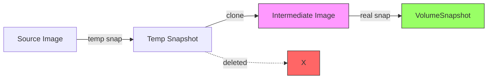
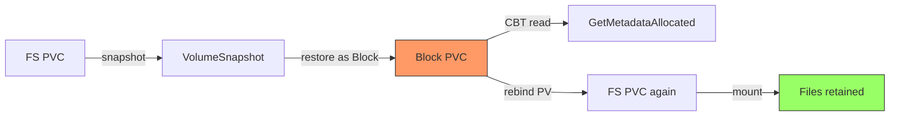
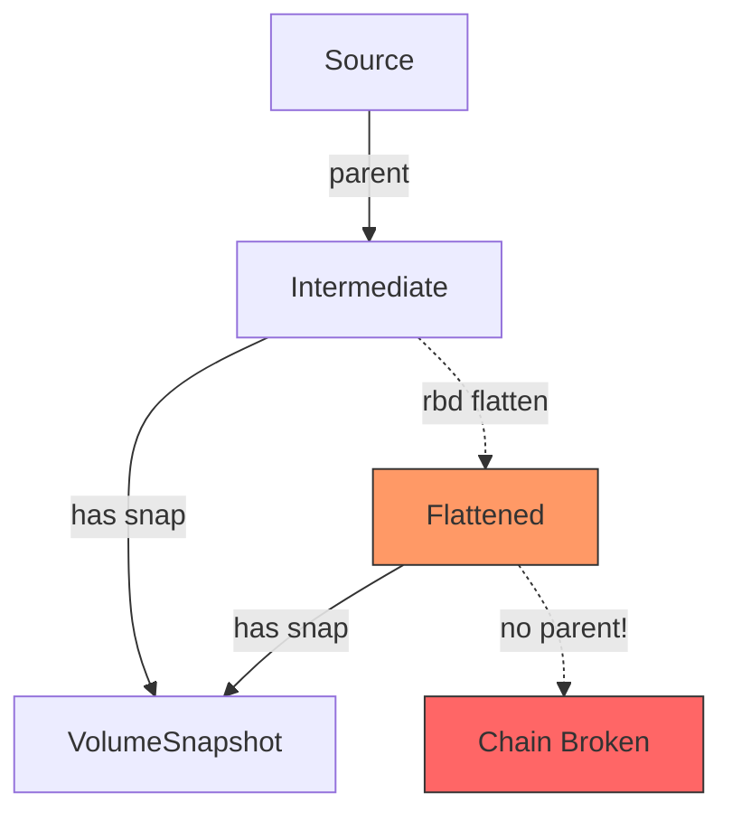

# CephCSI CBT Validation for Velero

Ceph RBD behavior coverage for incremental backup enablement

  

    
    
    
  

  
CBT: copy only the blocks that changed

For CBT intro & getting started, see [k8s-cbt-s3mover-demo](https://github.com/kaovilai/k8s-cbt-s3mover-demo)

  
    Press Space to begin <carbon:arrow-right class="inline flare-nudge"/>
  

<!--
- This deck focuses on Ceph-specific CBT behaviors validated for Velero enablement
- CBT intro (KEP-3314, APIs, demo) is covered in the k8s-cbt-s3mover-demo presentation
- Goal: document what works, what doesn't, and what Velero needs to know about Ceph RBD
-->

---
transition: slide-left
---

# Why Ceph-Specific Validation?

CBT (KEP-3314, beta since K8s 1.36, no feature gate) defines a generic API, but **each CSI driver has unique behaviors**.

<v-clicks>

- CephCSI uses an **intermediate image + snapshot** architecture (not direct snapshots)
- Clone chains and flattening create **Ceph-specific failure modes** for `GetMetadataDelta`
- Velero's Block Data Mover needs to know which **retention strategies** work with Ceph
- Volume mode conversion (FS to Block) has **Ceph-specific preconditions**

</v-clicks>

<v-click>

**This test suite validates Ceph RBD behaviors** that Velero must handle correctly for incremental backups on ODF/Rook clusters.

</v-click>

<!--
- Generic CBT tests (hostpath driver) don't exercise clone chains or flattening
- Ceph's snap-clone architecture means each VolumeSnapshot creates a new RBD image
- Velero can't treat Ceph like a simple snapshot-in-place driver
-->

---
transition: slide-left
---

# CephCSI Snap-Clone Architecture

Each VolumeSnapshot creates an **intermediate RBD image** -- not a direct snapshot on the source:

<v-clicks>

1. **Temp snapshot** on source PVC's RBD image
2. **Clone** to new intermediate image (format 2, deep-flatten)
3. **Delete** temp snapshot
4. **Snapshot** on intermediate image = VolumeSnapshot

</v-clicks>

<v-click>

</v-click>

<v-click>

Source PVC accumulates **zero** direct RBD snapshots. Each VolumeSnapshot gets its own intermediate image. This means `GetMetadataDelta` must traverse **across images** via parent chain.

</v-click>

<!--
- This architecture is critical to understand before looking at test results
- Intermediate images are what get flattened, not application volumes
- rbd diff --from-snap needs the parent chain intact to compute deltas
-->

---
transition: slide-left
---

# Validated Coverage Overview

Full backup works. Incremental on Ceph does not work yet: the old snapshot is deleted.

| Area | Velero Relevance | Status |
|---|---|---|
| **GetMetadataAllocated** | Full backup: finds used blocks | Works |
| **GetMetadataDelta** | Incremental backup: changed blocks | Works only if the old snapshot is kept |
| **Case 1: delete old snap** | Delete previous snap after backup (Velero default) | 1.19.0 (not released) default on Ceph: delta fails, backup falls back (data correct) |
| **Case 2: keep old snap** | Keep previous snap for delta (needed for Ceph) | <strong>Not in 1.19.0</strong> (not released); required for Ceph |
| **FS volume as blocks** | Read a file-system volume as raw blocks | Works |
| **Restore to FS volume** | Restore blocks back to a file-system volume | Works |
| **Flattening prevention** | Shallow chains stay intact | Works (shallow chains) |
| **Post-flatten delta** | Delta after snapshot chain broken | Fails (Velero auto-fallback to full) |
| **Volume resize + CBT** | CBT after PVC expansion | Works |
| **Error handling** | Invalid/deleted snapshot refs | Errors are clear, no crash |

works
works, with a fallback or a condition
not available in 1.19.0

Fall back = copy more data, not just changes. Slower, data correct.
Flattening = Ceph merges the snapshot chain; this breaks delta.
CBT = changed block tracking: copy only the changed blocks.

<!--
- Green: works today, Velero can rely on it
- Case 1 is the 1.19.0 default; on Ceph the delta call fails and the backup degrades instead of failing
- Post-flatten delta failure is expected -- no stored diffs mechanism exists
-->

---
transition: slide-left
---

# Snapshot Retention: Critical for Velero

Ceph RBD **requires** retaining the previous snapshot for `GetMetadataDelta`.

<v-click>

  

    <h3 class="text-red-600 dark:text-red-400 font-bold">Case 1: Delete Previous</h3>
    1.19.0 default
  

  
Velero deletes the old snapshot after backup

  

    snap 1
    
    snap 2
    compare
  

  

  - Ceph needs both snapshots to compare
  - Delete one, and it cannot compare
  - **Fails:** Ceph cannot find the old snapshot

  

</v-click>

<v-click>

  

    <h3 class="text-green-600 dark:text-green-400 font-bold">Case 2: Retain Previous</h3>
    not in 1.19.0 yet
  

  
Velero keeps the old snapshot until the next backup

  

    snap 1
    
    snap 2
    compare
  

  

  - Both snapshots stay available
  - `GetMetadataDelta` succeeds
  - **Required** for Ceph RBD (pending in Velero)

  

</v-click>

<v-click>

Ref: the [merged Velero design](https://github.com/velero-io/velero/pull/9528) defines the two cases.

- **1.19.0 (not released) will not support Case 2.** Velero deletes the old snapshot, so Ceph incrementals fall back. Data is still correct.
- **Planned fix:** a 1.19.x patch ([#10743](https://github.com/velero-io/velero/issues/10743), [#10744](https://github.com/velero-io/velero/issues/10744)); Velero itself would decide which snapshot to keep, not a storage setting.
- **Kept from [PR #10307](https://github.com/velero-io/velero/pull/10307):** the changeID fix, which sends the correct snapshot ID.

</v-click>

<!--
- Velero design doc defines Case 1 and Case 2 retention strategies
- 2026-10-27 community meeting: 1.19.0 drops the class-inherit behavior (rollback of part of #10307, merged in [#10753](https://github.com/velero-io/velero/pull/10753)); the changeID fix stays
- Ceph RBD requires Case 2 because rbd diff traverses the parent chain
- Test: velero_compliance_test.go -- negative test asserts Case 1 fails at the CSI layer; Velero then falls back
-->

---
transition: slide-left
---

# Volume Mode Conversion Workflow

Velero's Block Data Mover uses **Block PVCs** for backup, even for Filesystem sources.

<v-clicks>

1. Create **Filesystem** PVC, mount it, write files
2. Snapshot the Filesystem PVC
3. Restore snapshot as **Block** PVC (KEP-3141 annotation)
4. Read CBT metadata from Block PVC
5. **Rebind** the PV back to Filesystem mode
6. Mount rebound PV -- verify original files intact

</v-clicks>

<v-click>

</v-click>

<v-click>

Validated: CephCSI preserves filesystem data through the Block detour. KEP-3141 annotation on VolumeSnapshotContent enables the mode switch.

</v-click>

<!--
- KEP-3141 allows volume mode conversion via annotation on VolumeSnapshotContent
- This is how Velero does incremental backups of filesystem volumes via CBT
- Rebind proves the underlying data survives the Block detour
-->

---
transition: slide-left
---

# Flattening: The Clone Chain Risk

CephCSI flattens intermediate images to manage clone depth and snapshot counts.

<v-clicks>

- **Clone depth**: soft=4 (async), hard=8 (blocking)
- **Snapshot count**: max=450, min=250
- Only intermediate clones flattened
- **Flattening severs the parent chain**

</v-clicks>

<v-click>

</v-click>

<v-click>

After flattening: `GetMetadataDelta` **fails** at the driver level -- `rbd diff` needs intact clone chain. **Velero degrades gracefully** -- the CBT bitmap ([PR #9736](https://github.com/velero-io/velero/pull/9736), merged) falls back to an allocated-blocks or full backup (Velero 1.19.0 is in development). `GetMetadataAllocated` can also fail in manual-flatten scenarios without stored diffs.

</v-click>

<!--
- Flattening is threshold-based, not priority-based
- No mechanism to prefer flattening deleted snapshots over alive ones
- This is the fundamental tension between CBT and CephCSI's clone management
- Velero BDM (design PR #9528, bitmap PR #9736) handles this gracefully with automatic fallback
-->

---
transition: slide-left
---

# Flattening Prevention: What Works Today

Validated: CephCSI does **not** flatten when clone depth is below soft limit.

**PVC -> Snap -> Restore -> Snap**

<v-clicks>

- Snapshot a PVC
- Restore PVC from snapshot
- Snapshot the restored PVC
- Intermediate images: **NOT flattened**
- `GetMetadataDelta`: **works**

</v-clicks>

**PVC -> PVC Clone -> Snap**

<v-clicks>

- Clone a PVC (PVC-to-PVC)
- Write to clone
- Snapshot the clone
- Clone image: **NOT flattened**
- `GetMetadataDelta`: **works**

</v-clicks>

<v-click>

For typical Velero workflows (backup -> restore -> re-backup), clone depth stays at 1-2. Flattening is not triggered. CBT remains functional.

</v-click>

<!--
- Clone depth 1-2 is well below soft limit of 4
- Velero's normal backup-restore cycle doesn't accumulate deep chains
- Risk only emerges with many consecutive restore-from-snapshot cycles
-->

---
transition: slide-left
---

# Post-Flatten Behavior (Stored Diffs Gap)

What happens when flattening **does** break the chain?

<v-clicks>

1. Create PVC, write data, create 3 snapshots
2. Verify parent chains intact via RBD toolbox
3. **Force-flatten** all intermediate images (`rbd flatten`)
4. `GetMetadataAllocated` -- can fail after manual flatten when CephCSI has no stored diffs fallback
5. `GetMetadataDelta` -- **fails** (no parent chain)
6. Verify omap: **no stored diffs** (CephCSI doesn't store them)

</v-clicks>

<v-click>

**Driver-level gap**: No "stored diffs in omap" mechanism exists in CephCSI. `GetMetadataDelta` fails for flattened snapshot pairs.

**Velero handling is merged for v1.19 (in development)**: when delta fails, the CBT bitmap ([PR #9736](https://github.com/velero-io/velero/pull/9736)) falls back to allocated blocks or a full backup, then incrementals resume from the new full backup. On Ceph RBD under 1.19.0, a deleted base snapshot takes this same path.

</v-click>

<!--
- This test manually triggers flatten to document the gap
- CephCSI PR #5347 uses rbd DiffIterateByID directly -- no driver-level fallback
- Velero BDM (design PR #9528, bitmap PR #9736) handles this with automatic fallback to a full backup
-->

---
transition: slide-left
---

# Backup Safety After Flattening

What happens to **existing backups** when Ceph flattens the clone chain?

<v-clicks>

- Backup data lives in **Kopia repository** (object storage like S3) -- completely independent of source RBD
- Once blocks are written to Kopia, source snapshots can be flattened, deleted, or cluster destroyed
- Kopia uses **content-addressed storage** (1MB chunks) -- every backup is self-contained
- Restores create **fresh PVCs** from repository data, never touching original snapshots
- **No user action needed** for existing backups when flattening occurs

</v-clicks>

<v-click>

**Post-flattening recovery cycle**: `incremental → incremental → [flatten] → full (auto) → incremental → incremental`. One full backup happens automatically, then incremental resumes.

</v-click>

<!--
- Flattening is a backup-creation-time concern only, not a data-safety concern
- All existing backups remain valid, restorable, and require no special treatment
- The only cost of flattening is one full backup (more data read + uploaded)
- Velero BDM bitmap fallback (PR #9736, merged May 2026) handles this transparently
-->

---
transition: slide-left
---

# Snapshot Accumulation Risk

Retaining snapshots for CBT can **trigger the flattening it's trying to avoid** (flattening = Ceph merges the chain, breaking delta).

<v-clicks>

1. Case 2 (keep the old snapshot) needs that snapshot to stay on the original volume.
2. Frequent backups (e.g., hourly) can pile up snapshots if retention is unmanaged.
3. At `maxSnapshotsOnImage` (default 450), CephCSI merges in-between snapshots (flattening).
4. Flattening merges the snapshot chain, so `GetMetadataDelta` fails and the backup falls back.
5. A new chain starts and incrementals resume until the snapshot count hits 450 again.

</v-clicks>

<v-click>

-  **Today (1.19.0, not released):** retains nothing, so no snapshots pile up, but Ceph backups fall back once the old snapshot is gone.
-  **Planned ([#10744](https://github.com/velero-io/velero/issues/10744)):** keep one snapshot per volume; delete it after the next backup succeeds, or when its backup is deleted. The count stays tiny.
- **In the earlier keep-snapshots version ([#9835](https://github.com/velero-io/velero/issues/9835)):** retained snapshots were never cleaned up, so they piled up.

</v-click>

<!--
- Self-defeating cycle: retain for CBT → more snapshots → triggers flatten → breaks CBT
- 1.19.0 avoids the cycle by not retaining, at the cost of incremental Ceph backups
- The pending design bounds it to one snapshot per chain
- Periodic full backups remain a sensible fallback for chains that already flattened
-->

---
transition: slide-left
---

# Volume Resize + CBT

Validated: CBT works correctly after PVC expansion.

<v-clicks>

- Create PVC (1Gi), write data, snapshot
- Expand PVC to 2Gi
- Write data to expanded region
- Snapshot expanded PVC
- `GetMetadataAllocated` on new snapshot: reports blocks in expanded region
- `GetMetadataDelta` between pre/post-resize: reports only new blocks

</v-clicks>

<v-click>

Velero can handle PVC resizes between backup cycles -- CBT correctly tracks blocks across size changes.

</v-click>

<!--
- Volume resize doesn't break clone chains
- rbd diff handles images of different sizes correctly
- Important for real-world scenarios where PVCs grow over time
-->

---
transition: slide-left
---

# Error Handling Validation

How CephCSI CBT responds to invalid requests:

<v-clicks>

| Scenario | Expected Behavior | Validated |
|---|---|---|
| Deleted VolumeSnapshot | Error with snapshot not found | Yes |
| Non-existent snapshot name | Error, no crash | Yes |
| Delta with unrelated snapshots | Error (not in same chain) | Yes |
| Delta with same snapshot twice | Error or empty result | Yes |
| Snapshot from different PVC | Error (different images) | Yes |

</v-clicks>

<v-click>

Velero needs graceful error handling from the driver to decide when to fall back to full backup vs. reporting a real failure.

</v-click>

<!--
- Error handling is important for Velero's retry/fallback logic
- CephCSI returns descriptive errors, not panics
- These tests ensure the sidecar + driver handle edge cases correctly
-->

---
transition: slide-left
---

# Velero Block Data Mover Status (2026-10-27)

Block data mover = Velero's block copier. Only #10743/#10744 matter for incrementals.

 **Decided**
- **1.19.0 (not released) will not support Case 2** (keep the old snapshot). The older keep-old-snapshots change was undone; its changeID fix (right snapshot ID) kept.
- The file system data mover never keeps snapshots.
- Case 2 needs a new design, aimed at a 1.19.x patch ([#10743](https://github.com/velero-io/velero/issues/10743), [#10744](https://github.com/velero-io/velero/issues/10744)).
- OADP 1.7: a target for Ceph CBT, not a commitment.

 **Merged**
- [#10698](https://github.com/velero-io/velero/pull/10698) restore fix for empty blocks
- [#10696](https://github.com/velero-io/velero/pull/10696) design doc order fixed
- [#10700](https://github.com/velero-io/velero/pull/10700) cleanup after interrupted deletion

 **Fixes in progress**
- [#10699](https://github.com/velero-io/velero/pull/10699) in-place restore (over the same volume) leaves a snapshot behind
- [#10708](https://github.com/velero-io/velero/pull/10708) draft fix: leftover snapshot entry after an interrupted backup
- [#10710](https://github.com/velero-io/velero/pull/10710) failed-backup snapshot cleanup
- [#10718](https://github.com/velero-io/velero/pull/10718) docs
- [#10691](https://github.com/velero-io/velero/pull/10691) draft code for #10744 (deleting kept snapshots)

 **Bugs not fixed yet**
- [#10724](https://github.com/velero-io/velero/issues/10724) data mover pod runs out of memory (closed as completed; [#10740](https://github.com/velero-io/velero/pull/10740) merged 2026-10-28)
- [#10730](https://github.com/velero-io/velero/issues/10730) restore hangs when volumes become ready late

<v-click>

**Worked in pre-rollback builds** (before that undo, which kept the old snapshot); 1.19.0 will not.

- Incremental backups of a 30 GiB volume were small (144 MiB, 150,994,944 B); restores matched (checksums), VMs booted, an extra disk added while running matched; in-place restore moved 258 MiB (270,532,608 B) in 22 s.

</v-click>

<!--
- 1.19.0 is in development; latest release is v1.18.4
- OOM: on 96 vCPU, default still OOMs; cpuLimit 2/8/16 gave peaks of 384/690/928 MiB, all passing (node-agent podResources)
- Deadlock workaround: restorePVC.ignoreDelayBinding: true
-->

---
transition: slide-left
---

# Summary: What Velero Needs to Know

 **Works with or without the old snapshot**
- `GetMetadataAllocated` for full backup
- File-system volumes backed up as raw blocks
- Restore back to a filesystem volume
- Volume resize between backups
- Shallow snapshot chains (few snapshots; typical workflows)
- Errors are clear, no crash
- **Automatic fallback** on CBT errors (copies more data, correct; [PR #9736](https://github.com/velero-io/velero/pull/9736) merged)

 **Works only with the old snapshot kept**
- `GetMetadataDelta` for incremental

**Constraints & User Actions**
-  **Incremental on Ceph does NOT work yet; full backup does.**
- **Velero 1.19.0 (not released) will not keep the old snapshot**: Ceph delta falls back once it is gone; no user setting restores incrementality yet
- Case 2 (keep the old snapshot) design: 1.19.x patch ([#10743](https://github.com/velero-io/velero/issues/10743), [#10744](https://github.com/velero-io/velero/issues/10744))
- Delta fails after flattening (Ceph merges the chain; Velero falls back: copies more data, slower, correct)
- **One narrow exception to the flattening line:** volumes restored read-only (ROX = ReadOnlyMany) skip merging, so incrementals still work; normal restores do not ([PR #6534](https://github.com/ceph/ceph-csi/pull/6534))
- **Existing backups stay safe:** no action needed after flattening.

<v-click>

**Optional (person):** a weekly or monthly full backup keeps a known-good full copy.

</v-click>

<!--
- 1.19.0 gives Ceph correct backups that fall back to full once the base is gone; incrementality waits for Case 2 in a 1.19.x patch (targeted for OADP 1.7, not committed)
- Flattening risk is low for typical workflows and handled by auto-fallback
- Existing backups are always safe -- data is in Kopia, independent of RBD
- Future CephCSI improvements (stored diffs, priority flatten) would reduce full-backup frequency
-->

---
transition: slide-left
---

# Key References

**CephCSI CBT**
- [PR #5347](https://github.com/ceph/ceph-csi/pull/5347) -- CBT RPCs (merged Jul 2025)
- [Issue #5346](https://github.com/ceph/ceph-csi/issues/5346) -- CBT feature request (closed by stale bot)
- [Design: rbd-snap-clone.md](https://github.com/ceph/ceph-csi/blob/devel/docs/design/proposals/rbd-snap-clone.md)

**Flattening**
- [PR #2900](https://github.com/ceph/ceph-csi/pull/2900) -- Flatten before create
- [PR #6534](https://github.com/ceph/ceph-csi/pull/6534) -- Skip flatten for ROX restores (v3.18.0)
- [PR #1678](https://github.com/ceph/ceph-csi/pull/1678) -- minSnapshotsOnImage
- [Issue #1800](https://github.com/ceph/ceph-csi/issues/1800) -- No-flatten request

**CBT API (upstream)**
- [KEP-3314](https://github.com/kubernetes/enhancements/blob/master/keps/sig-storage/3314-csi-changed-block-tracking/README.md) -- CBT design, beta in K8s 1.36
- [KEP-3314 PR #6479](https://github.com/kubernetes/enhancements/pull/6479) -- documents `requireBaseSnapshotForDelta` (open)
- [external-snapshot-metadata#258](https://github.com/kubernetes-csi/external-snapshot-metadata/pull/258) -- field merged, not released

**Velero BDM + CBT**
- [BDM Design (merged)](https://github.com/velero-io/velero/pull/9528) -- PR #9528
- [CBT Interfaces (merged)](https://github.com/velero-io/velero/pull/9716) -- PR #9716
- [CBT Bitmap (merged)](https://github.com/velero-io/velero/pull/9736) -- PR #9736
- [ChangeId for Ceph (closed)](https://github.com/velero-io/velero/issues/9714) -- Issue #9714
- [changeID fix (merged; class-inherit rolled back)](https://github.com/velero-io/velero/pull/10307) -- PR #10307
- [Case 2 umbrella](https://github.com/velero-io/velero/issues/10743) -- Issue #10743
- [Case 2 design](https://github.com/velero-io/velero/issues/10744) -- Issue #10744
- [Base-snapshot retention draft](https://github.com/kaovilai/velero/blob/design-base-snapshot-retention/design/block-data-mover/base-snapshot-retention.md) -- proposals for 1.19.x
- [BLKZEROOUT restore fix (merged)](https://github.com/velero-io/velero/pull/10698) -- PR #10698
- [CBT Integration Plan](https://hackmd.io/@velero/r1U1EVKdgl)

**Setup & Getting Started**
- [CBT sidecar for ODF](https://access.redhat.com/articles/7130698) -- Developer Preview (KCS for ODF 4.20)
- Early ODF 4.21 sidecar is older; this suite overrides it with `csi-snapshot-metadata` v0.2.0
- [k8s-cbt-s3mover-demo](https://github.com/kaovilai/k8s-cbt-s3mover-demo) -- CBT intro & demo
- [This test suite](https://github.com/kaovilai/cephcsi-cbt-e2e)

<!--
- PR #5347 is the core CBT implementation using rbd DiffIterateByID
- Block Data Mover design doc defines retention strategies
- k8s-cbt-s3mover-demo covers CBT basics and getting started
- Test suite results are from ODF/OCP 4.21 with the v0.2.0 sidecar override; ceph-csi 3.18, ODF 4.22 and external-snapshot-metadata v1.1.0 are not yet validated here
-->

---
layout: center
class: text-center
---

# Thank You!

Questions?

  
CephCSI CBT Validation for Velero

  
github.com/kaovilai/cephcsi-cbt-e2e

<!--
- Repo: github.com/kaovilai/cephcsi-cbt-e2e
- CBT intro: github.com/kaovilai/k8s-cbt-s3mover-demo
- CBT sidecar setup: access.redhat.com/articles/7130698
-->
